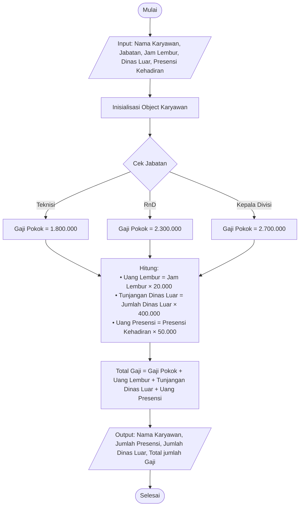

# pemlan_TM2 - Sistem Payroll

## Flowchart



## Output Program

### Contoh Input:
```text
=== Input Data Karyawan ===
Nama Karyawan            : Budi Santoso
Jabatan (Teknisi / RnD / Kepala Divisi): RnD
Jam Lembur               : 10
Jumlah Dinas Luar        : 2
Jumlah Presensi Kehadiran: 20
```

### Output:
```text
========================================
Nama Karyawan      : Budi Santoso
Jumlah Presensi    : 20
Jumlah Dinas Luar  : 2
Total jumlah Gaji  : Rp 4300000
========================================
```
